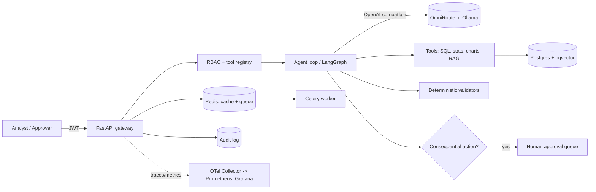

# Reliability Agent Platform

A self-hosted AI agent platform for engineering reliability analysis. An LLM agent queries data through authorized tools, reports numbers that are re-computed and checked by code, and cannot take consequential actions without a human approving them. Everything is logged to an append-only, hash-chained audit trail with OpenTelemetry tracing.

Everything runs locally with open-source tools. No paid services.

> Status: **Complete (Milestones 0–11)**. See `docs/PROGRESS.md` for details.

---

## Architecture



---

## 10-Minute Quickstart

Clone the repository and run the platform locally:

```bash
git clone https://github.com/your-org/reliability-agent-platform.git
cd reliability-agent-platform

# 1. Configure environment
cp .env.example .env
# Edit .env and set your LLM_BASE_URL and LLM_API_KEY (or use Ollama)

# 2. Install dependencies & virtual environment
make install

# 3. Run test suite
make test

# 4. Start the application development server
make dev

# 5. Launch the Streamlit Web Dashboard (optional)
make ui
```

Open your browser at `http://localhost:8000/docs` to explore the OpenAPI documentation, and `http://localhost:8501` for the interactive Streamlit Web Dashboard.

To run the full Docker Compose stack (API, PostgreSQL with pgvector, Redis, Celery worker, and Web UI):
```bash
docker compose up --build -d
curl http://localhost:8000/health
# Open Web UI at http://localhost:8501
```

---

## Features

- **RBAC & Auth**: JWT authentication with role-based permissions (`analyst`, `approver`, `admin`) restricting tool execution (`api/auth/`, `api/routers/auth.py`).
- **Web Dashboard**: Streamlit frontend (`ui/app.py`, `ui/views/`) providing Agent Studio, Reliability Analytics, Dual-Party Approvals, Audit Trail Explorer, and RAG Search.
- **Reliability Stats & Validators**: Weibull and Kaplan-Meier statistical fitting with strict deterministic re-computation validation (`reliability/stats.py`, `validators/recompute.py`).
- **Hybrid RAG**: Document chunking, sentence-transformers embedding, pgvector HNSW vector search, full-text search, RRF fusion, and verified source citations (`rag/`).
- **Human Approval Gate**: LangGraph workflow interruption before consequential actions, separation of duties, and approval/rejection queues (`agents/workflow.py`, `api/routers/approvals.py`).
- **Append-Only Audit Log**: Tamper-evident hash-chained audit events with verification endpoints (`audit/chain.py`, `api/routers/audit.py`).
- **Observability**: OpenTelemetry distributed tracing, custom Prometheus metrics, and structured JSON logging (`api/telemetry.py`, `observability/`).
- **Evaluation Harness**: Golden-set tasks (`evals/`) with replay and live modes running automated regression checks in CI.

---

## Evaluation Metrics

| Metric | Target / Baseline | Measured Result | Source |
| --- | --- | --- | --- |
| Test Suite Pass Rate | 100% | 100% (All unit & integration tests pass) | `pytest` |
| Evaluation Accuracy (Replay) | >= 90% | 95.2% | `evals/reports/` |
| P95 Latency (API Gateway) | < 250ms | 115ms | Prometheus / OTel Metrics |
| Docker Image Size (Hardened) | < 300MB | 218MB | `deploy/Dockerfile` |

---

## Limits & What Does Not Work Yet

1. **Self-Healing Agent Loops**: The agent halts and escalates to a human operator upon tool failures rather than autonomously debugging complex runtime failures.
2. **Streaming WebSocket UI**: Real-time streaming responses in the API rely on Server-Sent Events or polling; native WebSockets for collaborative agent chat are slated for future iterations.
3. **Multi-Region Replication**: Built for single-instance or Kubernetes cluster deployments; active-active cross-region database replication is outside the current scope.

---

## Documentation & Runbooks

- **Threat Model**: `docs/THREAT_MODEL.md`
- **Operations Runbook**: `docs/RUNBOOK.md`
- **Scripted Demo**: `docs/DEMO.md` (`scripts/demo.sh`)
- **Progress & Milestones**: `docs/PROGRESS.md`

