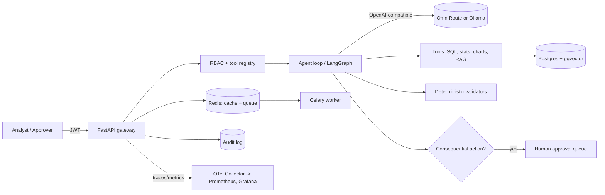

# Plan

## What we are building

A platform where an analyst asks a question about reliability data ("which turbofan units look closest to
failure, and what is the fitted Weibull shape?") and an LLM agent answers it using authorized tools.

Four guarantees make it trustworthy, and each one maps to a requirement in the Intel posting:

| Guarantee | How it is delivered | Milestone |
| --- | --- | --- |
| Only the right people do the right things | JWT login, roles, per-role tool permissions | 1, 3 |
| Numbers are correct | Code re-computes every number the model reports | 4 |
| Nothing consequential happens unreviewed | Approval gate, separation of duties, rollback | 6 |
| Everything is traceable | Hash-chained audit log, OpenTelemetry traces | 5, 9 |

## Architecture

## Milestones

Do them in order. Each has a prompt in `docs/prompts/`.

| # | Milestone | Depends on | Roughly |
| --- | --- | --- | --- |
| 1 | Auth, roles, datasets API on Postgres | skeleton | 3 days |
| 2 | Redis cache and background jobs | 1 | 2 days |
| 3 | Tool-calling agent from scratch | 1 | 3 days |
| 4 | Reliability stats tools and validators | 3 | 4 days |
| 5 | Append-only audit log | 1, 3 | 2 days |
| 6 | Human approval gate and rollback (LangGraph) | 3, 5 | 4 days |
| 7 | RAG module with citations | 1 | 4 days |
| 8 | Evaluation harness gated in CI | 4, 7 | 3 days |
| 9 | Observability: traces, metrics, dashboards | 3 | 3 days |
| 10 | Deployment: Compose, Helm, kind, security scans | all | 4 days |
| 11 | Docs, threat model, demo, resume | all | 2 days |

## Data

- NASA C-MAPSS turbofan run-to-failure data. NASA's own data.gov listing for the simulator said it was
  unavailable for download when this plan was written. Use the Hugging Face mirror or NASA's Prognostics
  Data Repository, and check the licence. Put files in `data/` (git-ignored). See `scripts/README_data.md`.
- SECOM semiconductor manufacturing data (UCI) for outlier analysis.
- Public technical PDFs (datasheets, standards) for RAG, 20 or more, in `data/docs/` (git-ignored).

## Security principles

1. Least privilege: every tool declares the roles allowed to call it.
2. Model output is untrusted: schema-validate it, never execute it.
3. Consequential actions need a different human than the requester.
4. The audit log cannot be edited, only appended to, and is verifiable.
5. Secrets live in environment variables, never in the repo.

## Definition of done (every milestone)

- Tests pass locally and in CI, including a failure-path test.
- `make lint` is clean.
- `docs/PROGRESS.md` updated, with anything left undone written down.
- The owner can explain every file in two minutes. If not, simplify it.
