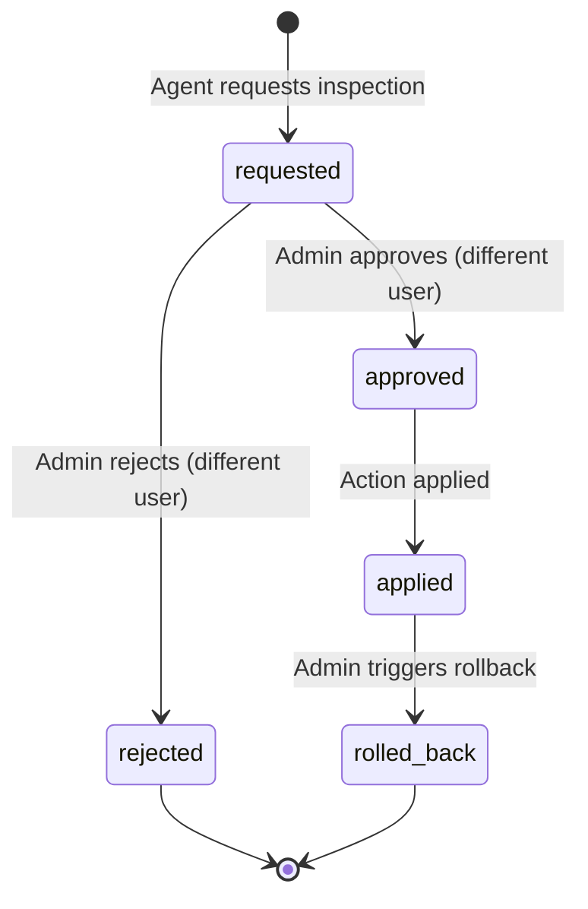

# Human Approval Gate and Rollback

The reliability agent platform enforces a strict separation of duties and human approval gate for consequential actions (such as flagging equipment units for physical inspection).

## State Diagram (Mermaid)

## Security & Governance Rules
1. **Separation of Duties**: The user who requested the inspection flag cannot approve or reject their own request, even if they hold admin privileges.
2. **Idempotency**: Approving or rejecting an already decided flag returns an error or handled status.
3. **Audit Trail**: Every request, approval, rejection, and rollback is recorded in the hash-chained append-only audit log.
4. **State Persistence**: Workflow execution checkpoints are persisted using checkpointers (MemorySaver in tests, Postgres checkpointer in production) so paused runs survive API restarts.
